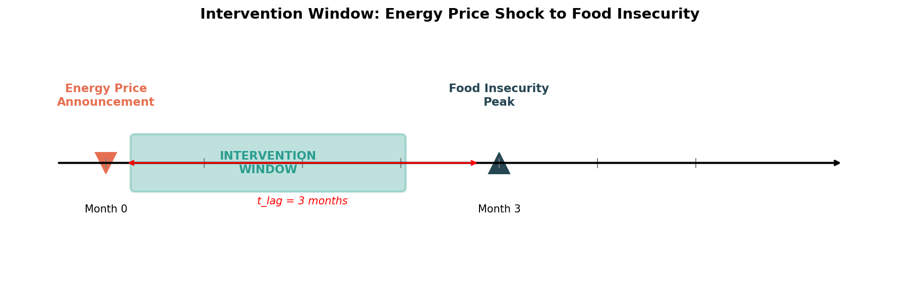
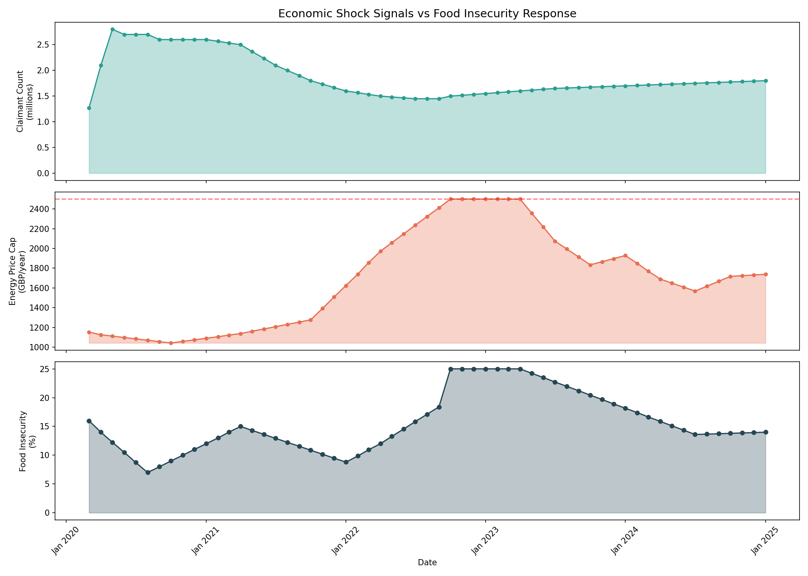
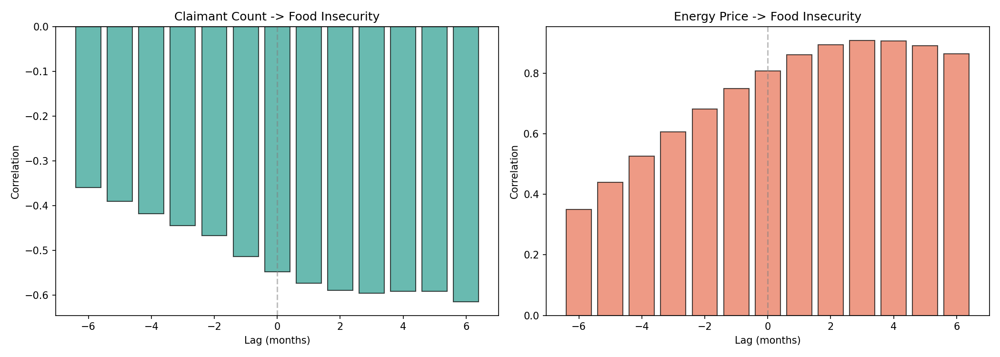
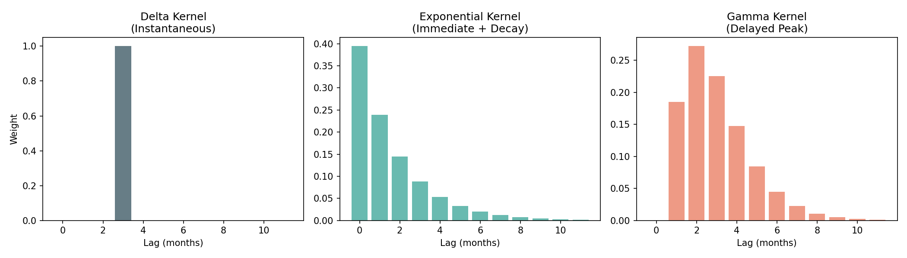
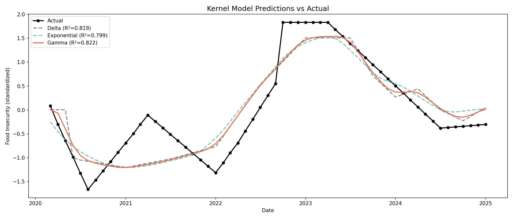
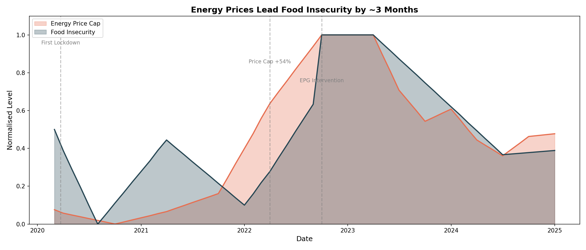

# Project Transfer Merton

**Systemic Latency Analysis of Food Insecurity in SW19**

This project models the *transfer function* between economic shocks and food insecurity to identify intervention windows for Merton ward councillors.

---

## Key Finding

> **Energy prices are a strong leading indicator for food insecurity (r = 0.91).**
>
> When the Ofgem price cap rises, food insecurity follows with a delay of approximately **3 months**, providing a window for preventive intervention.



---

## Background

We treat the social safety net as a dynamic system where economic "shocks" propagate through to household food insecurity with a measurable delay (τ_lag). Identifying this delay allows policymakers to act *before* a crisis peaks.

### Data Sources

| Source | Coverage | Role |
|--------|----------|------|
| [Ofgem Energy Price Cap](https://www.ofgem.gov.uk/energy-price-cap) | 2020-2025 | Shock signal |
| [Food Foundation Tracker](https://foodfoundation.org.uk/initiatives/food-insecurity-tracking) | 2020-2025 | Response signal |
| [London Datastore Economic Fairness](https://data.london.gov.uk/economic-fairness/) | 2003-2018 | Historical context |

---

## Methodology

### 1. Time Series Alignment

Economic indicators and food insecurity surveys were resampled to monthly frequency and aligned on a common timeline.



### 2. Cross-Correlation Analysis

We computed the correlation between energy prices and food insecurity at various time lags (0-6 months) to identify which indicator leads and by how much.



**Result:** Peak correlation (r = 0.91) occurs at lag = 3 months, meaning energy price rises precede food insecurity peaks by approximately 3 months.

### 3. Bootstrap Uncertainty

Bootstrap resampling (n=1000) was used to quantify uncertainty in the lag estimate:
- **95% CI:** 0-3 months
- The relationship is strong across all lags, indicating immediate pressure with peak impact at 3 months

### 4. Kernel Fitting

We model the transfer function between energy prices and food insecurity using parameterized kernels. Three kernel shapes were tested:

| Kernel | Description | R² | Key Parameter |
|--------|-------------|-----|---------------|
| Delta | Instantaneous effect at fixed lag | 0.819 | lag = 3 months |
| Exponential | Immediate onset, gradual decay | 0.799 | decay = 0.26 |
| **Gamma** | Delayed peak, then decay | **0.822** | peak = 2.5 months |



The **Gamma kernel** provides the best fit, with a peak response at 2.5 months. This confirms that food insecurity does not respond immediately to price shocks, but builds over 2-3 months as household budgets deplete.



---

## Results

### Temporal Dynamics

The cost-of-living crisis (2022) demonstrates the lag clearly:



- **April 2022:** Price cap increased 54%
- **September 2022:** Food insecurity peaked at 18.4%
- **Lag:** ~3-5 months

### Correlation Summary

| Indicator | Correlation | Optimal Lag | Interpretation |
|-----------|-------------|-------------|----------------|
| Energy Price Cap | r = 0.91 | 3 months | Strong leading indicator |
| Claimant Count | r = -0.36 | n/a | Different shock dynamics |

---

## Policy Implications

### Intervention Window

When Ofgem announces a significant price cap increase, councillors have **0-3 months** to deploy preventive measures:

| Intervention | Lead Time | Target |
|--------------|-----------|--------|
| Emergency fuel vouchers | Immediate | Fuel-poor households |
| Food bank referral pathways | 1 month | GP surgeries, schools |
| Council tax hardship fund | 1-2 months | Low-income households |
| Benefit uptake campaigns | 2-3 months | Eligible non-claimants |

### Monitoring Recommendation

Track Ofgem price cap announcements (quarterly). When the cap increases >10%, trigger the intervention protocol.

---

## Project Structure

```
Project-Transfer_Merton/
├── README.md
├── CLAUDE.md                 # AI assistant instructions
├── pyproject.toml            # Dependencies (uv.lock pins them)
├── assets/                   # Figures for documentation
├── data/
│   ├── raw/                  # Immutable source files
│   │   ├── economic_fairness/
│   │   └── food_insecurity/
│   └── processed/            # Cleaned parquet files
├── notebooks/
│   ├── 01_data_ingestion.ipynb
│   ├── 02_exploratory_viz.ipynb
│   ├── 03_correlation_study.ipynb
│   ├── 04_lag_estimation.ipynb
│   ├── 05_kernel_fitting.ipynb
│   └── 06_synthesis.ipynb
├── src/
│   ├── api/                  # Data source connectors
│   │   ├── nomis.py          # Claimant Count API
│   │   └── octopus.py        # Energy price API
│   ├── models/               # Vulnerability kernel implementations
│   │   ├── kernels.py        # Delta, Exponential, Gamma kernels
│   │   └── bayesian.py       # PyMC Bayesian inference
│   └── dashboard/            # Monitoring system
│       └── monitor.py        # Price cap alerts
├── outputs/                  # Generated figures and results
└── docs/
    ├── plans/                # Design documents
    └── policy_report.md      # Report for councillors
```

---

## Limitations

1. **National vs Local:** Food insecurity data is UK-wide; Merton-specific patterns may differ
2. **Sample Size:** Analysis covers one economic cycle (2020-2025)
3. **Causation:** Correlation does not prove causation
4. **Data Gaps:** Historical economic indicators end ~2018; food tracking starts 2020

---

## Next Steps

1. **Localise:** Obtain Merton-specific food bank data to validate national patterns
2. **Dashboard:** Build real-time monitoring on Raspberry Pi (per original spec)
3. **Evaluate:** Track intervention effectiveness when triggered by this model

---

## Technical Stack

- **Python 3.10+**
- **polars** — Data manipulation
- **scipy.signal** — Cross-correlation
- **matplotlib** — Visualisation
- **PyMC** — Bayesian inference (optional)

---

## License

See [LICENSE](LICENSE) for details.
