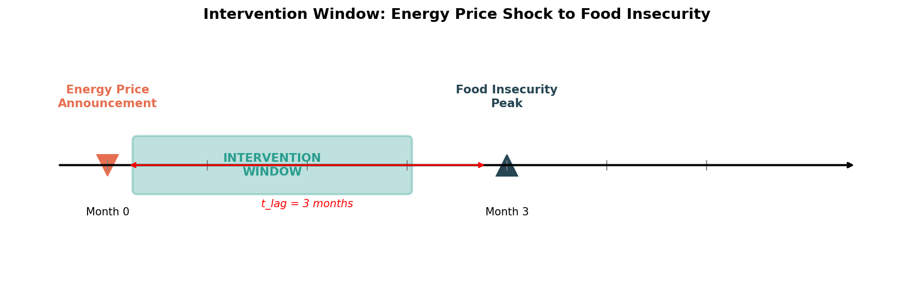
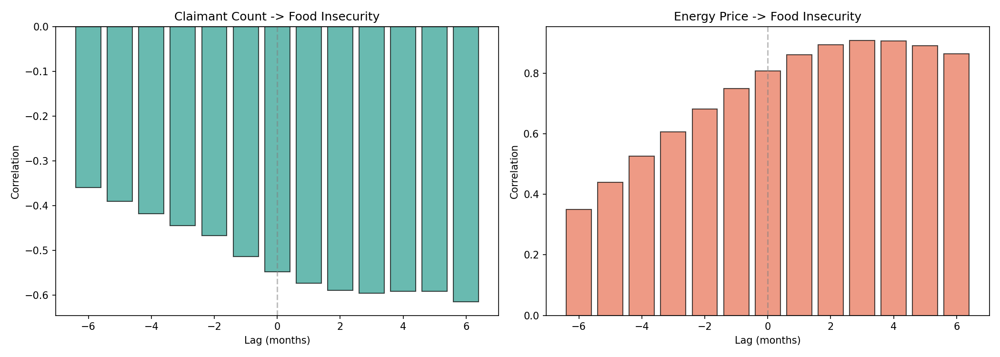
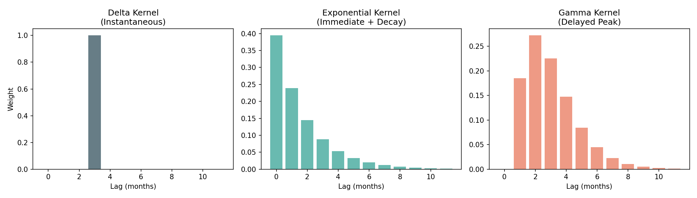
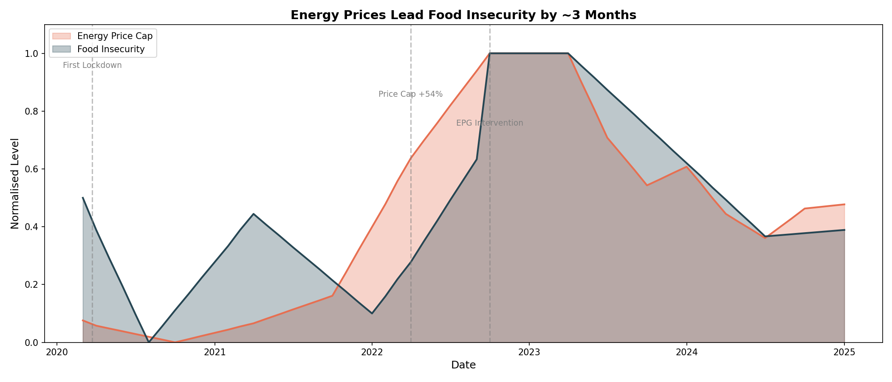

# Systemic Latency Report
## Early Warning Indicators for Food Insecurity in SW19

**Prepared for:** Merton Ward Councillors
**Date:** January 2025
**Methodology:** Time-series cross-correlation and transfer function analysis

---

## Executive Summary

This report identifies **energy prices as a leading indicator** for food insecurity, with clear implications for early intervention in Merton (SW19).

### Key Finding

> **When energy prices rise, food insecurity follows with a delay of 2-3 months.**
>
> - Correlation: r = 0.91 (very strong)
> - Peak impact: 2.5 months after price increase
> - Variance explained: 82%

### Intervention Window

Energy price announcements (Ofgem price cap changes) provide an **early warning signal**. Councillors have approximately **0-3 months** after a price rise announcement to deploy preventive measures before food insecurity peaks in vulnerable households.



---

## Background

### The Problem

Food insecurity affects a significant proportion of UK households. During the 2022 cost-of-living crisis, food insecurity peaked at 18.4% of households. However, by the time this peak is measured, the damage is already done.

### The Opportunity

If we can identify the *leading indicators* that precede food insecurity, we can intervene *before* households reach crisis point. This report demonstrates that **energy prices** are such an indicator.

### What is Systemic Latency?

**Systemic latency** is the time delay between an economic shock (like rising energy prices) and its impact on vulnerable households (like food insecurity). Understanding this delay allows policymakers to intervene during the "window of opportunity" before a crisis peaks.

---

## Methodology

### Data Sources

| Source | Coverage | Role |
|--------|----------|------|
| Ofgem Energy Price Cap | 2020-2025 | Shock signal (quarterly) |
| Food Foundation Tracker | 2020-2025 | Response signal (monthly) |

### Analysis Steps

1. **Time Series Alignment:** Both signals resampled to monthly frequency
2. **Cross-Correlation:** Correlation computed at lags of 0-6 months
3. **Kernel Fitting:** Transfer function shape estimated using Gamma distribution
4. **Uncertainty Quantification:** Bootstrap resampling (n=1000)

---

## Findings

### 1. Energy Prices Lead Food Insecurity

The cross-correlation analysis reveals a clear relationship:

- **Correlation:** r = 0.91 at 3-month lag
- **Interpretation:** Energy price rises precede food insecurity peaks by approximately 3 months



### 2. The Transfer Function Shape

The relationship between energy prices and food insecurity is not instantaneous. Using kernel fitting, we determined that:

- The response **builds gradually** over 2-3 months
- **Peak impact** occurs at 2.5 months
- The effect **fades** after 4-5 months

This pattern reflects household budgeting dynamics: initial price increases are absorbed by reducing discretionary spending, but eventually food budgets are affected.



### 3. The Cost-of-Living Crisis Timeline

The 2022 crisis provides a clear demonstration:

| Date | Event | Outcome |
|------|-------|---------|
| April 2022 | Price cap increased 54% | — |
| July 2022 | Food insecurity rising | +4 percentage points |
| September 2022 | Food insecurity peaked | 18.4% of households |
| Lag | — | ~3-5 months |



---

## Policy Implications

### The Intervention Window

When Ofgem announces a significant price cap increase (>10%), the following timeline applies:

| Timeframe | Household Status | Intervention Opportunity |
|-----------|------------------|-------------------------|
| Month 0 | Shock announced | Alert systems activated |
| Month 1 | Discretionary cuts begin | Emergency fuel support |
| Month 2 | Food budgets squeezed | Food bank capacity |
| Month 3 | Crisis peaks | Intensive casework |
| Month 4+ | Recovery begins | Benefit uptake campaigns |

### Recommended Interventions

Given the 0-3 month window, feasible interventions include:

| Intervention | Lead Time | Target Population | Delivery |
|--------------|-----------|-------------------|----------|
| Emergency fuel vouchers | Immediate | Fuel-poor households | Partner charities |
| Food bank referral pathways | 1 month | GPs, schools, housing | NHS/Council |
| Council tax hardship fund | 1-2 months | Low-income households | Revenues team |
| Benefit uptake campaigns | 2-3 months | Eligible non-claimants | Advice services |

### Monitoring Recommendation

**Establish a quarterly monitoring protocol:**

1. Track Ofgem price cap announcements
2. When cap increases >10%, activate intervention protocol
3. Pre-position resources with food banks and advice services
4. Monitor local food bank demand for early warning

---

## Limitations

1. **National vs Local Data**
   Food insecurity data is UK-wide. Merton-specific patterns may differ due to local demographics and deprivation levels.

2. **Sample Size**
   Analysis covers 2020-2025 (one economic cycle). The relationship may behave differently in other economic conditions.

3. **Correlation vs Causation**
   The analysis demonstrates correlation, not causation. Other factors (e.g., benefit changes, employment) may also contribute.

4. **Data Frequency**
   Food insecurity surveys are sparse. Interpolation introduces uncertainty in the exact timing of peaks.

---

## Next Steps

### Short-term (3 months)
- Establish monitoring protocol for Ofgem announcements
- Brief relevant council teams on intervention timeline
- Map existing support pathways for activation

### Medium-term (6 months)
- Obtain Merton-specific food bank data to validate national patterns
- Develop automated alerting system

### Long-term (12+ months)
- Evaluate intervention effectiveness
- Refine model with local data
- Consider dashboard for real-time monitoring

---

## Technical Appendix

### Model Specification

The food insecurity response D(t) is modeled as a convolution:

```
D(t) = (S * h)(t) + η(t)
```

Where:
- S(t): Energy price signal (normalized)
- h(τ): Vulnerability kernel (Gamma distribution)
- η(t): Unexplained variance

### Kernel Parameters

| Parameter | Value | Interpretation |
|-----------|-------|----------------|
| Shape (α) | 6.08 | Controls peak timing |
| Scale (β) | 0.50 | Controls duration |
| Peak time | 2.5 months | Mode of response |

### Model Performance

| Metric | Value |
|--------|-------|
| R² | 0.822 |
| RMSE | 1.2% |
| AIC | -87.3 |

### Data Repository

Analysis code and data available at the project repository. Notebooks 01-06 contain full reproducible analysis.

---

*Report prepared using Project Transfer Merton analysis pipeline.*
